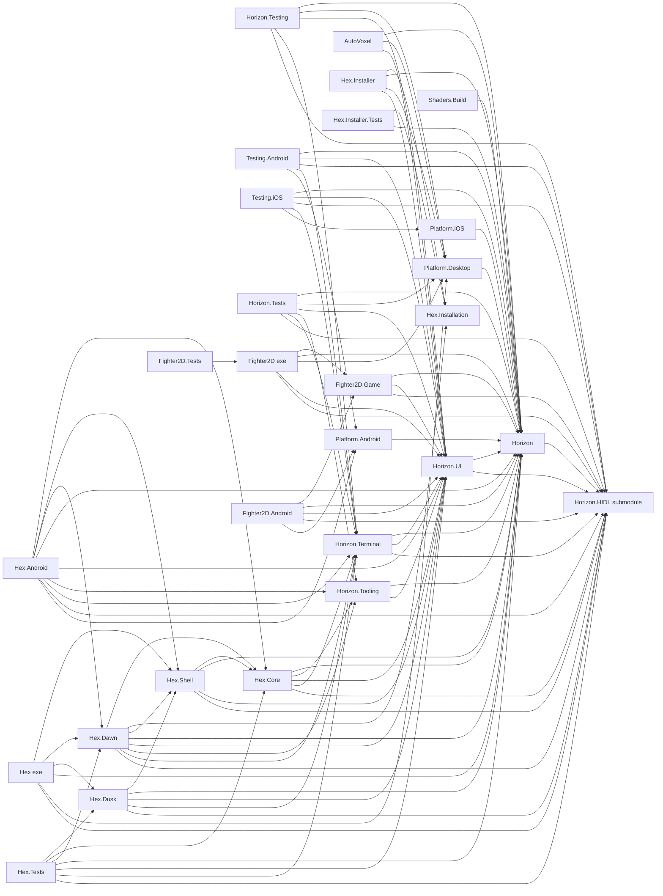

# Workspace map (cross-cutting)

Root: `C:\Users\bogdan\source\repos\bogzxo\horizon` (itself the git repo `bogzxo/workspace`, branch `development`).
All facts were read from files in the tree; "unclear" marks what was not verifiable.

## 1. Repo layout

| Folder | Own `.git`? | Remote | What it is |
| --- | --- | --- | --- |
| `.` (workspace) | yes | `github.com/bogzxo/workspace` | scripts, root `Directory.Build.props`, `global.json`, `Horizon.Workspace.sln`, `tasks.hor`, README |
| `horizon/` | yes | `bogzxo/horizon` | the engine (Horizon, UI, Terminal, Tooling, platforms, tests, shader builder) |
| `horizon/Horizon.HIDL/` | yes (submodule of the engine, `branch = development`) | `bogzxo/hidl` | HIDL language/runtime/parser (`Horizon.HIDL.csproj`, net11.0, no project refs) |
| `hex/` | yes | `bogzxo/hex` | Hex, the editor (Dawn = GUI mode, Dusk = terminal mode) |
| `hex/hex-extensions/` | submodule (`hex/.gitmodules`, branch `main`) | `bogzxo/hex-extensions` | Hex extensions; Hex needs it present (a copy of hex without it misbehaves) |
| `Fighter2D/` | yes | `bogzxo/fighter-2d` (private) | the game |
| `tools/` | **no** (plain folder, `/tools/` in `.gitignore`) | - | local tools only, e.g. `tools/slang/` (slang.exe + DLLs). `git` run inside it resolves to the workspace repo. |
| `hidl/`, `dusk/` | yes (stray checkouts) | `hidl` = `bogzxo/hidl` (on `development`); dusk: unclear | NOT part of the workspace (`.gitignore`: "here on bogz's machines and aren't part of it"). Ignore. |
| `hex/horizon/` | empty, ignored | - | CI puts an engine clone here; locally unused |
| `Fighter2D/external/` | - | - | CI puts an engine clone at `external/horizon`; locally unused |
| `docs/context/` | workspace repo | - | these agent-facing maps |

Workspace `.gitignore`: `/horizon/ /hex/ /Fighter2D/ /tools/ /hidl/ /dusk/ .vs/ .stignore ~$* /artifacts/`. `.gitattributes`: `*.cmd`/`*.ps1` CRLF, `*.sh` LF. The engine's `.gitattributes` forces LF for shell-integration scripts (`*.bash *.zsh *.fish *.sh`, `Horizon/Assets/terminal/shell/zsh/.*`). Root also holds a stray Excel lock file `~$Horizon performance 2026-10-07.xlsx` (ignored by `~$*`).

### Branches
- Everyone works on `development` (README: "Everything is on `development`"); `master` is what is released (hex docs). Other local branches: `perf/android-gpu` (every repo, checked out in a linked worktree), `platform` (engine), `release/hex-2.9.0-smallman` (engine), `release/2.9.0-smallman` (hex).
- Remote default HEAD differs: engine and Fighter2D `origin/HEAD -> master`, hex `origin/HEAD -> development`.
- hex and Fighter2D CI always check out the **engine's `development`**.

### Push/pull order and why
- `pull-all.cmd|ps1` (`setup.cmd|ps1` = check Git + SDK, then run pull-all): order workspace, engine (`horizon`), HIDL inside it (kept on its own `development`, not the engine's pinned commit), Hex (+ extensions submodule), Fighter2D. Clones what is missing, stashes uncommitted work around the pull, skips a repo where both sides have new commits (then `git -C <repo> pull --rebase` by hand).
- `push-all.cmd|ps1 [-DryRun]` (also Hex automations): HIDL -> engine (first commits a bump of its `Horizon.HIDL` pointer, message `HIDL at <subject>`, if HIDL moved) -> hex -> Fighter2D -> workspace. Reason: Hex and the game build against the engine on GitHub, so GitHub must never hold a game commit that needs an unpushed engine commit.
- Push-all stops before pushing anything when: GitHub has commits not pulled locally; an unpushed commit message matches the AI-credit regex (`co-authored-by: claude`, `generated with claude`, `noreply@anthropic.com`), so **commit messages in these repos carry no AI attribution**; a repo has no upstream branch; the HIDL commit is not on GitHub. Uncommitted work is left and reported.
- Nothing pins the engine any more (commits "The engine isn't a submodule any more, Hex builds against whatever engine is next to it", same for the game). Only HIDL is still a submodule of the engine.

## 2. Build system

### SDK and frameworks
- `global.json` is identical in workspace, `horizon/`, `hex/`: SDK `11.0.100-rc.2.26504.105`, `rollForward: latestMajor`, `allowPrerelease: true`. Fighter2D has none (the workspace one applies in-tree). CI: `dotnet-version: 11.0.x`, `dotnet-quality: preview`.
- TFMs: `net11.0` nearly everywhere; `net11.0-android` (Horizon.Platform.Android, Horizon.Android.Probe, Horizon.Testing.Android, Hex.Android, Fighter2D.Android); `net11.0-ios` (Horizon.Platform.iOS, Horizon.Testing.iOS). `LangVersion preview` in most engine projects; `ImplicitUsings` and `Nullable` enabled everywhere; `AllowUnsafeBlocks` in most.
- No central package management (no `Directory.Packages.props`), no `nuget.config`; versions inline in csproj. Pins: Silk.NET 2.23.0, xunit 2.9.3, Microsoft.NET.Test.Sdk 18.10.1, xunit.runner.visualstudio 3.1.5, Slangc.NET 2026.19.0 (Horizon), TextMateSharp 2.0.4 (UI), DotTiled 1.0.0, NVorbis 0.10.5, Stb*Sharp, Svg.Skia 5.2.3 + CSharpMath.SkiaSharp + SkiaSharp Linux assets (Hex.Dawn), Riptide 2.2.1 + ImageSharp 3.1.12 (Fighter2D.Game).

### How the engine is referenced (key mechanism)
- Hex and the game use **ProjectReference to engine source**, never NuGet. Each csproj has `<HorizonRoot Condition="'$(HorizonRoot)' == ''">...</HorizonRoot>` (Hex: `$(MSBuildThisFileDirectory)..\horizon\`; Fighter2D: `...external\horizon\`) and `<ProjectReference Include="$(HorizonRoot)Horizon\Horizon.csproj" />` etc.
- Root `Directory.Build.props` sets, unless `-p:UseSubmodules=true`: `HorizonRoot=<workspace>\horizon\` and `HidlRoot=<workspace>\horizon\Horizon.HIDL\`. Inside the workspace hex and Fighter2D therefore compile the one shared engine checkout, so an engine edit is seen immediately.
- MSBuild takes only the nearest `Directory.Build.props`, so `hex/Directory.Build.props` and `horizon/Directory.Build.props` each `GetPathOfFileAbove(..)` and `<Import>` the workspace one by hand. Fighter2D has no props of its own (walk-up reaches the workspace one).
- Outside the workspace (lone clone / CI) the csproj fallback applies: `hex/horizon`, `Fighter2D/external/horizon` (CI clones `bogzxo/horizon@development`, `submodules: recursive`).
- `-p:UseSubmodules=true` = ignore the workspace override, build against the repo's own nested engine copy.
- Versions: `horizon/Directory.Build.props` -> `Version 1.2.0` for projects named `Horizon*`; `hex/Directory.Build.props` -> `Version 3.0.0`, `VersionName Solstice` for `Hex*`. Hex release notes: `hex/RELEASE_NOTES.md`.

### Solutions
- `Horizon.Workspace.sln`: folders Engine/Examples/Game/Hex/Tooling/horizon; all engine projects including Platform.Desktop/Android/iOS, Testing(.Android/.iOS), Tests, AutoVoxel, Shaders.Build, Android.Probe; Fighter2D, Fighter2D.Game, Fighter2D.Android, Fighter2D.Tests; all Hex.* incl. Hex.Android, Installer, Installer.Tests. Includes mobile heads, so a full build may want the android workload (iOS only builds on a Mac). Prefer building specific projects.
- `horizon/Horizon.sln`: desktop only (Horizon, HIDL, UI, Terminal, Tooling, Platform.Desktop, Testing, Tests, AutoVoxel, Shaders.Build). Android/iOS deliberately excluded ("building a desktop must never need the Android workload", Platform.Android csproj comment). The engine `tasks.hor` comment that Shaders.Build "isn't in the solution" is stale.
- `hex/Hex.sln`: Hex, Hex.Shell/Dawn/Dusk/Core/Installer/Installation/Tests, Installer.Tests, plus engine projects at `horizon\...` (resolves only if `hex/horizon` is populated; whether it loads cleanly in the workspace is unclear).
- `Fighter2D/Fighter2D.sln`: Fighter2D, Fighter2D.Game, Fighter2D.Tests.

### Exact commands
| Thing | Command |
| --- | --- |
| Engine, desktop | `cd horizon; dotnet build Horizon.sln` (CI: `--configuration Debug` and `Release`) |
| Engine tests | `dotnet test Horizon.Tests/Horizon.Tests.csproj` (CI: `--no-build --blame-hang-timeout 3m --blame-hang-dump-type none`) |
| Shader tests only | `dotnet test Horizon.Tests/Horizon.Tests.csproj --filter "FullyQualifiedName~Horizon.Tests.Shaders"` |
| Engine checks / examples | `dotnet run --project Horizon.Testing/Horizon.Testing.csproj --no-build -- --checks` (or an example id; list in `horizon/tasks.hor` `EXAMPLES`) |
| Hex | `cd hex; dotnet build Hex/Hex.csproj`; all: `dotnet build Hex.sln` |
| Hex unit tests | `dotnet test Hex.Tests/Hex.Tests.csproj` (CI Release, `--blame-hang-timeout 5m`; needs Python 3.13 and `pip install -r Hex.Tests/engineering-requirements.txt`) |
| Hex installer tests | `dotnet test Hex.Installer.Tests --configuration Release` |
| Hex self tests (window + Vulkan GPU; not in CI) | `Hex/bin/Debug/net11.0/Hex --selftest --exit --size 1600x900`; parts `--selftest code\|layout\|workspace\|extensions\|garbage` (~100 s total). Run from the real bin folder. |
| Run Hex | `dotnet run --project Hex/Hex.csproj --no-build -- --window` |
| Hex publish (NativeAOT) | `dotnet publish Hex/Hex.csproj -c Release -r win-x64` (linux-x64, osx-arm64...); needs VS C++ tools / clang + zlib1g-dev / Xcode CLT. Installer: `dotnet publish Hex.Installer/Hex.Installer.csproj -c Release -r <rid>` |
| Game | from root `dotnet build Fighter2D`; in folder `dotnet build`, `dotnet run --no-build` |
| Game tests | `dotnet test Fighter2D.Tests/Fighter2D.Tests.csproj` (headless fight tests) |
| Game publish | `dotnet publish Fighter2D.csproj -c Release -r win-x64 -p:Platform=x64` (NativeAOT, exe + Assets) |
| Android (NativeAOT) | `dotnet publish -c Release -r android-arm64 -p:PublishAot=true` in `Fighter2D.Android`, `Horizon.Testing.Android`, `Hex.Android`; needs `dotnet workload install android`, JDK 21, Android SDK. iOS on the MacBook only (see memory notes). |
| APK shader check | `horizon/scripts/verify-apk-shaders.ps1` |

### Shader build step
- Shaders are Slang under `horizon/Horizon/shaders/{common,lighting,models,particle,post,primitives,renderer2d,spritebatch,tilemap}`, compiled at runtime through `Slangc.NET` (with a cache). A prebuilt pack `horizon/Horizon/shaders/packed/horizon.hzshaders` (for phones: no Slang, no cache) is built from a **manifest** `horizon/Horizon/shaders.manifest`.
- `Horizon.Shaders.Build` (console exe) commands: `build|verify|check|refresh|info --manifest <file> --content <bin dir> [--out pack]`; exit 0 ok, 1 manifest/pack wrong, 2 bad usage.
- The workflow is the `horizon/tasks.hor` automations: record the manifest (runs every check and example with `HORIZON_SHADER_MANIFEST` set, Git Bash), build the pack, check freshness. After editing a shader: refresh or record the manifest, rebuild the pack, commit both; `check` fails when the manifest is behind sources. Env switches: `HORIZON_SHADERS=packed`, `HORIZON_SHADER_CACHE=off`, `HORIZON_AUDIO=off`.
- `tools/slang/` is a local compiler copy (not in git).

## 3. Project dependency graph

Layering (Horizon.csproj comment): `Horizon` runtime knows nothing of UI/Terminal/Tooling; UI sits on it; Terminal and Tooling on top; HIDL is standalone because the language has an editor that wants nothing of the engine. Hex.Installation has no engine reference. Hex.Core references only the engine; Hex.Shell references Core (no cycle).

| Repo | Consumes from engine | Notes |
| --- | --- | --- |
| Hex.* | Horizon, UI, Tooling, Terminal, HIDL, Platform.Desktop (Hex exe, Installer) / Platform.Android | `Hex.Core` and `Hex.Installation` set `WarningsAsErrors IL2026;IL3050` (trim/AOT safety) |
| Fighter2D | Horizon, UI, HIDL, Platform.Desktop / Platform.Android | `Fighter2D.Game` = platform-neutral gameplay lib; `Fighter2D.csproj` = desktop head; tests reference the exe project |

## 4. CI (GitHub Actions)
- `horizon/.github/workflows/ci.yml` (push master/development/platform, PR to master/development, manual): job `test` = {windows, ubuntu, macos} x {Debug, Release}: submodules recursive, `dotnet build Horizon.sln`, `dotnet test Horizon.Tests --no-build` (3 min hang blame). Debug matters because the Skyline debugger and its tests are Debug-only; no GPU needed. Job `android-probe` (ubuntu): android workload + JDK 21, builds `Horizon.Android.Probe` Debug. This is the gate.
- `horizon/.github/workflows/build.yml` (push master, `v*` tag): publishes AutoVoxel and Horizon.Testing self-contained for win-x64, linux-x64, osx-arm64 as zip artifacts; a `v*` tag makes a GitHub release.
- `hex/.github/workflows/ci.yml` (push master/development, PR): checks out hex + `bogzxo/horizon@development` into `horizon/`; Release builds `Hex/Hex.csproj` and `Hex.Installer`, runs `Hex.Installer.Tests` and `Hex.Tests` on win/linux/mac. Self tests are not run (need GPU).
- `hex/.github/workflows/build.yml` (push master, `v*` tag): NativeAOT publish of Hex + installer for win-x64, linux-x64, osx-arm64, osx-x64, linux-arm64, win-arm64; checks Windows exe uses the GUI subsystem and setup is a single EXE; builds macOS icon and `.app`; tag must equal `Version` in `hex/Directory.Build.props`; release title/notes come from `RELEASE_NOTES.md` (prerelease if tag has `-` or notes say preview).
- `Fighter2D/.github/workflows/build.yml` (push master, `v*` tag): engine `development` into `external/horizon`, NativeAOT publish of `Fighter2D.csproj` for win/linux/mac. **No ci.yml, so no test run in CI**; game tests are local only.
- Workspace repo: no `.github` seen. HIDL repo CI: not checked.
- Consequence: a broken engine `development` breaks hex/game CI on the next run, since they track it.

## 5. tasks.hor automations
`tasks.hor` is HIDL-syntax, read by Hex (palette: Automation; Terminal > Run Automation; Ctrl+Shift+B runs the `build` group default, F5 the `run` one; fields `command folder group default depends_on terminal(panel|dusk)`).
- Workspace: **Pull all** (pull-all.ps1 via pwsh or powershell), **Push all**, **Push all (dry run)** (implemented in the script: fetch, AI-credit scan, behind check, then HIDL, engine, `hex`, `Fighter2D`, `.`), **Status of every repository** (`git status -sb` in `.`, HIDL, engine, hex, Fighter2D).
- `horizon/tasks.hor`: tasks `build` (builds Shaders.Build, depends on `build_solution`), `build_solution` (`dotnet build Horizon.sln`), `test`, `test_shaders`, `checks`, `run`; automations "Record shader manifest", "Build shader pack", "Check shader manifest", "Refresh shader manifest", "Checks with packed shaders".
- `hex/tasks.hor`: `build` (Hex.csproj), `build_all` (Hex.sln), `test`, `run` (`--window`, depends on build).
- `Fighter2D/tasks.hor`: `build` (`dotnet build`), `run` (`dotnet run --no-build`), both in a Dusk window.

## 6. Analyzers and warnings
- One `.editorconfig` only: `horizon/.editorconfig` (`CS8618` silent). No analyzer packages and no `TreatWarningsAsErrors` anywhere found. `Horizon.csproj`: `WarningLevel 4`, `IsAotCompatible`, `IsTrimmable`, `InvariantGlobalization`. Only `IL2026;IL3050` are errors (Hex.Core, Hex.Installation). `horizon/qodana.yaml` exists (not a CI gate seen).
- Engine, Hex and game publish with NativeAOT, so new reflection outside HIDL's rooted pieces fails `IL2026/IL3050`.

## 7. Code style (sampled from `Horizon.UI/Components/Collapsible.cs`, Hex.Core, engine)
- File-scoped namespaces (`namespace Horizon.UI.Components;`), ~596 files vs 17 without in the engine; namespace mirrors folder. Occasional `global using` (Hex.Core).
- Allman braces, 4 spaces. Usings at the top, loosely grouped.
- Long plain-English `/// 
` on types (with `<code>` HIDL snippets); `//` comments explain why in full sentences.
- Constants SCREAMING_SNAKE (`ARROW_STEPS`), private fields camelCase with no underscore (`expanded`, `openness`), PascalCase for types/members, nullable annotated (`IRuntimeValue?`).
- Big classes split into partials by concern (`UICompositor.Input.cs`, `HexScene.*.cs`, `UIModule.*.cs`).
- Tests: xunit; test folders mirror source areas. British spelling in comments ("colour").

## 8. Commit message conventions (from `git log`)
- Author `bogzxo` (older `Bogdan`, one contributor `Niel de Villiers`).
- One sentence, sentence case, no prefix, no trailing period, describing the outcome or behaviour. Optional body is a prose paragraph (what and why), no bullets. Legacy `feat:` prefix seen once. Merges: "Merge development with the current workspace work", "Bring X together".
- Examples: "A label handed a new width wraps to it the same frame"; "Horizon runs on iOS"; "Vulkan 1.4 now, push descriptors and host image copies"; "Release Hex 3.0.0 Solstice"; "Hex 2.8.0 thickboy"; "Keep local tools out of the workspace repository"; auto "HIDL at <subject>" from push-all.
- Release commits `Release Hex X.Y.Z <Name>`. No AI credit lines (push-all blocks them). Commit only when asked; push only through push-all, by the owner.
- Old game commits "The engine submodule at <engine subject>" are legacy (submodule removed).

## 9. Pitfalls
1. Engine and game/Hex out of step ("nine times out of ten" in the README): `pull-all`, rebuild. No older engine pin exists; a broken engine is fixed in the engine.
2. An engine/UI/HIDL API change breaks Hex and Fighter2D at once; fix all in the same session, push in order.
3. The workspace `Directory.Build.props` only applies inside this folder; CI and lone clones use `hex/horizon` / `Fighter2D/external/horizon`. A path hack that works locally can break CI.
4. `hex/docs/hacking.md` still says "The engine is a submodule at `horizon/`": stale (hex `.gitmodules` only lists hex-extensions).
5. `Horizon.Workspace.sln` holds Android/iOS heads, `Horizon.sln` does not.
6. Shader edits need a manifest/pack refresh or `Horizon.Shaders.Build check` fails.
7. Hex self tests need a GPU/window and must run from `hex/Hex/bin/...`. Some engine tests are Debug-only: run Debug as well as Release.
8. A Hex release tag must equal `Version` in `hex/Directory.Build.props`.
9. `hidl/` and `dusk/` at root are not what builds use (that is `horizon/Horizon.HIDL`).
10. Fighter2D has no CI test gate; run `Fighter2D.Tests` yourself.
11. Windows shell: tasks use Git Bash; `.cmd/.ps1` are CRLF.
12. Parallel agent copies must carry `hex-extensions` and a baseline commit (see memory notes).

## 10. Where to look for X
| Need | Look at |
| --- | --- |
| How a repo finds the engine | root `Directory.Build.props`; `HorizonRoot` in each csproj |
| SDK / TFM | `global.json`, csproj `TargetFramework` |
| Hex / engine version | `hex/Directory.Build.props`, `horizon/Directory.Build.props` |
| CI | `*/.github/workflows/*.yml` |
| Push/pull behaviour | `pull-all.ps1`, `push-all.ps1`, root `tasks.hor` |
| Engine runtime | `horizon/Horizon/{Core,Engine,Graphics,Rendering,Input,Audio,Physics,Content,Platform,Logging}` |
| UI | `horizon/Horizon.UI/{Components,Layout,Skinning,Scripting,Drawing}` |
| Terminal / tooling | `horizon/Horizon.Terminal`, `horizon/Horizon.Tooling` |
| HIDL language | `horizon/Horizon.HIDL/{Lexing,Parsing,Runtime,...}`, its `README.md`, `docs` |
| Shaders / pack | `horizon/Horizon/shaders`, `shaders.manifest`, `horizon/Horizon.Shaders.Build` |
| Examples / checks | `horizon/Horizon.Testing`, `horizon/AutoVoxel` |
| Engine tests | `horizon/Horizon.Tests/{Audio,Content,Core,Physics,Platform,Rendering,Scripting,Shaders,UI}` |
| Hex architecture | `hex/docs/hacking.md`, `hex/Hex.Dawn` (`HexScene.*.cs`), `hex/Hex.Dusk`, `hex/Hex.Core`, `hex/Hex.Shell` |
| Hex extensions / agents | `hex/hex-extensions`, `hex/docs/extensions.md`, `hex/docs/agents.md` |
| Hex tests | `hex/Hex.Tests`, self tests in Hex's `Testing/` folder |
| Installer | `hex/Hex.Installer`, `hex/Hex.Installation`, `hex/docs/installer.md` |
| Android | `hex/docs/android.md`, `*.Android` projects |
| Game | `Fighter2D/Fighter2D.Game`, top-level folders (Arena, Fight, Fighters, Match, Menus, Simulation, Input, Networking, HUD), `Fighter2D/Fighter2D.Tests` |
